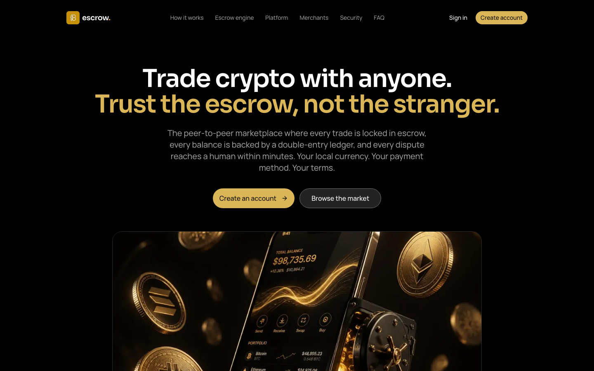

# f8 escrow

**Peer-to-peer crypto trading where every trade is locked in escrow.**

[**▶ Live demo**](https://f8cutoutpro.vercel.app) · [More of my work](https://github.com/fondoadam) · [Hire me](mailto:fondoadam@f8ware.com)

## What it does

Two people agree a price. The platform locks the seller's crypto, the buyer pays the seller directly (PayPal, bank transfer, mobile money), the seller confirms, and the platform releases the crypto. The platform never touches the fiat.

## Highlights

- Platform-held escrow on every trade
- Double-entry ledger behind every balance
- Human dispute resolution, with a full audit trail
- Local currencies and local payment methods

## Built with

Next.js · React · Convex · Better Auth · Tailwind CSS · Motion · Recharts

## Source code

This is a showcase repository. The source is private because it is a commercial product.
I'm happy to walk through the architecture and code on a call. [Get in touch](mailto:fondoadam@f8ware.com).

---

Built by **[Fondo Adam](https://github.com/fondoadam)**: full-stack web & mobile engineer in Kenya. [Portfolio](https://fondoadam.f8ware.com)
